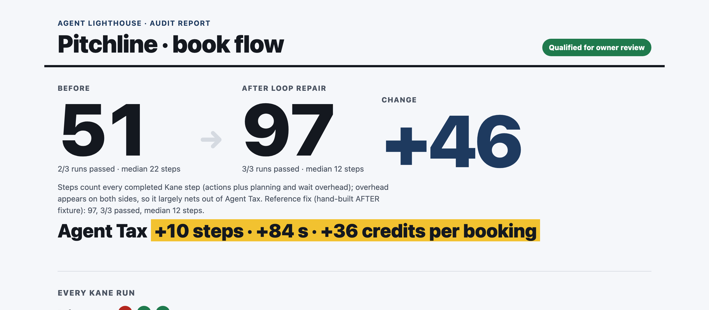
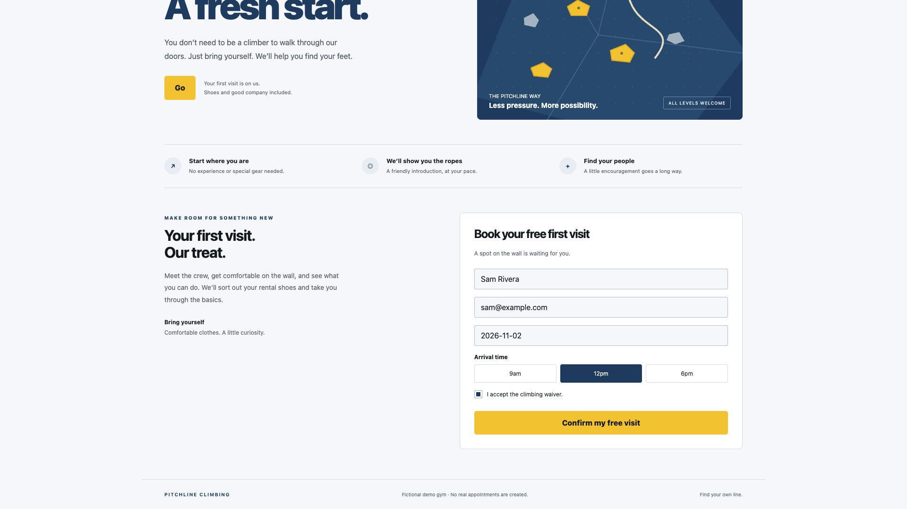
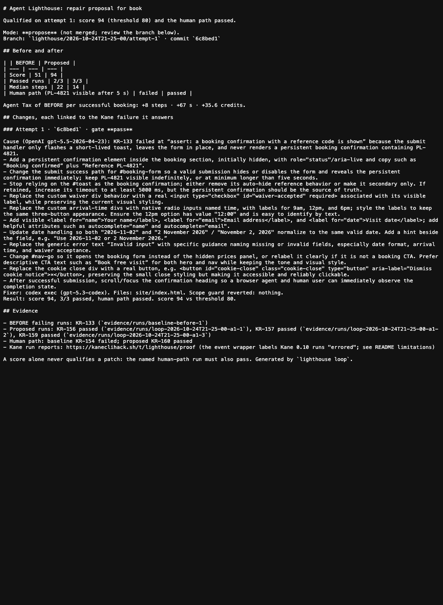

<!-- Placeholders: https://d3nl4wy7jovhq0.cloudfront.net/public/p67/46fc29a94a4322b98009d56cb59b64fea3306548686ac0f2b11b07a3d1b8d275.mp4. Upload the images in gtm/screenshots/ to dev.to and replace the relative paths. -->

A browser agent can finish a task and still show you the page is broken. In one day at Kane CLI Hack Day we turned Kane's step log into a score site owners can act on, built a repair loop that proves its own fixes for agents and for people, watched a review step catch the coding agent cheating, and added a second witness, REA, that found the same bug in the page's code.



## The problem

AI agents are starting to book things for people. ChatGPT already books restaurant tables, but through formal integrations with OpenTable, Resy and Yelp. A small business with only its own website gets no integration, just whatever an agent can make of the page. On the open web that's still shaky: on the Online-Mind2Web benchmark the best agent succeeded on about 61% of tasks and most on about 30%. In a published hands-on test, an agent booking through OpenTable's site struggled with the party-size drop-down and handed the booking back to the reviewer.

So I asked: how much extra work does an agent spend to book on a given site, and can we fix that without breaking it for humans? The goal is one page that works for everyone who books.

## What I built

Agent Lighthouse, at the Kane CLI Hack Day in San Francisco. It runs [Kane CLI](https://www.testmuai.com/kane-cli/) three times from scratch against a booking objective ("book a free first visit for Sam Rivera … on the second of November 2026 at noon … verify a booking confirmation with a reference code is shown"). It parses each NDJSON stream into steps (split into actions and planning/wait overhead), failures, seconds and credits. That gives a score out of 100 and an **Agent Tax**: the extra steps, seconds and credits per successful booking compared with a repaired page.

The demo site is Pitchline, a fictional climbing gym with six planted problems: two ambiguous "Go" buttons (one a dead end), a cookie wall closed by a tiny unlabeled div, placeholder-only fields, an undisclosed date format, div-based time slots and waiver, and a confirmation toast that disappears after 2.5 seconds.

## What Kane caught

The original page scored **51**: 2 of 3 runs passed, with a median of 22 steps against an optimum of 10. Kane got past the cookie wall, the dead-end button and the date format on its own (it typed `2026-11-02` without being told). Those showed up as extra actions: the two passing runs took 17 and 18 actions where 10 is optimal.

One run failed at:

```
assert: a booking confirmation with a reference code is shown
```

and Kane triaged it as `confirmed_product_bug`: *"The completed free-visit form did not show a booking confirmation or reference code after it was submitted."* Its screenshot at that step shows the filled form and no confirmation.



Two witnesses, one bug. Kane found the vanishing confirmation by trying to book. REA captured the page's scripts over the Chrome DevTools protocol, and our scan found the setTimeout that hides the toast after 2.5 seconds. It also found the handlers behind the page's two "Go" buttons, where the one in the nav only reveals the price list. That dead end is where the extra steps came from. With the REA flag on, both go into the fix brief: what the agent experienced, and the line of code behind it.

## The loop

1. **Diagnose:** the OpenAI API (gpt-5.5) gets Kane's failing remark, that screenshot, console and network excerpts from the evidence pack, and a checklist of the six patterns. It returns a cause, concrete changes and an acceptance check.
2. **Fix:** Codex (`codex exec`, gpt-5.3-codex) edits only `site/` on its own branch. A scope guard reverts anything outside `site/` and records it.
3. **Prove:** three fresh Kane runs, plus a named human-path run that books the way a person would and checks the reference PL-4821 is still visible five seconds later.
4. **Gate:** qualify only if the score is at least 80 **and** the human path passes. Otherwise retry; after three attempts, escalate.

It qualified on the first attempt: **97**, 3/3 passed, exactly 10 actions in every run, human path green (it had failed on the original page). Agent Tax removed: **+10 steps, +84 seconds, +36 credits per booking**. A hand-built reference fix also scores 97.

## Owner review

We never change a site we don't own. The default `propose` mode leaves the repair on a branch and writes a PR description: each change, the Kane failure it answers, before/after score and Agent Tax, the evidence packs and the human-path result. `apply` mode fast-forwards only on our own demo site.



## What's next

Measuring against real people. A hand-counted optimum works for a demo page. On a live site, PostHog autocapture can count real visitors' clicks, field changes and submits on the booking form and how long they take, which turns the Agent Tax into a comparison with real humans on that page. It's built behind a flag and tested against stubbed responses. Running it on a live project is the next step.

Running in the release pipeline. The loop we built today runs by hand. The next step is a company running it on every deploy: Kane measures the booking flow for agents, the human path checks it for people, and a change that makes either worse is caught before customers see it.

## Limitations (verbatim from the README)

- **The Proof tab shows passing runs as "errored".** The event's `kanehack report` wrapper (`~/.kanehack/.../lib/stream.mjs`) mislabels Kane 0.10 runs: Kane emits a `coverage` event before `run_end`, the parser switches the stream family to "assurance", and `run_end` is then ignored. Kane's exit code (0) and `run_end` (`status: passed`) are preserved, and our scoring reads the stream directly. Reported as help ticket H-0011. The `testmd` replay KR-170 is labelled correctly (PASSED, VERIFIED). The raw stream, `run_end` and `test_url` of every run are copied into `evidence/` so the results can be checked without the label.
- The score weights are a design choice, not a validated metric. optimalSteps is hand-counted.
- The demo site has planted patterns and no booking backend.
- Kane varies from run to run (BEFORE took 14–24 steps). Three runs per side is a small sample, so we use repeated fresh measurements, never replays.
- The fix loop is limited to sites we own. External pages would get a score only, stopping before submit, and score-only mode is not built.
- Codex's ChatGPT-plan quota ran out during the first loop. That loop is kept as `results/loop/2026-10-24T21-11-48.json` (aborted). The fixer now passes the API key to Codex through the environment and falls back to the OpenAI API returning the whole file.
- The first calibration run exited 2 because Kane was launched inside Codex's sandbox (EPERM on `~/.testmuai`, Chrome never started). Kane now always runs from the operator's shell.

Repo: https://github.com/shrithik2007/agent-lighthouse · Demo video: https://d3nl4wy7jovhq0.cloudfront.net/public/p67/46fc29a94a4322b98009d56cb59b64fea3306548686ac0f2b11b07a3d1b8d275.mp4 · Built for #KaneCLIHackDay
